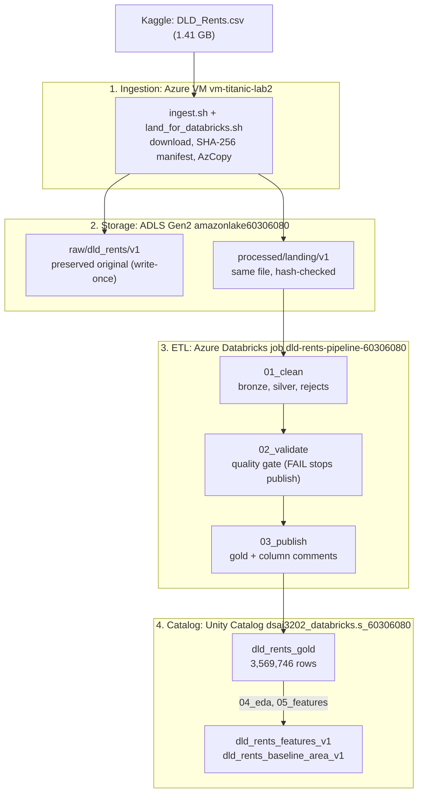

# Predicting Fair Monthly Rent for Dubai Ejari Contracts: Phase 1

**Team:** Muzayyan Parkar (60305825), Mohamad Zain (60306080)
**Course:** DSAI3202, Project Phase 1 (data pipeline, ETL, catalog, EDA and initial features)
**Submitted version:** git tag `phase1-v1` ([browse this version](../../tree/phase1-v1))

Phase 1 turns the 1.41 GB Dubai Land Department rent file into a cleaned, validated and catalogued
table of **3,569,746 residential Ejari contracts**, plus a versioned feature table and the baseline lookup
for Phase 2. Everything runs on Azure: a VM for ingestion, ADLS Gen2 for storage, an Azure Databricks job
for ETL, and Unity Catalog for the published tables.

---

## Project and hypothesis

**Problem.** Tenants need to judge whether a quoted rent is fair before signing or renewing; landlords and
brokers need a competitive asking rent. We predict the **fair monthly rent (AED)** of a residential Ejari
contract from the property's details (supervised regression).

**Target.** `monthly_rent_aed = annual_amount / 12`. `annual_amount` already converts every contract to a
one-year value, so the monthly figure is comparable whatever the contract length. The model is trained on
`log_monthly_rent` because rents are heavily skewed (EDA: skewness 1,565 on the raw scale, 0.62 on the log scale).

**Baseline plan.** Predicted rent = property size (m²) × the area's median monthly rent per m², computed
from the **training years only**; areas not seen in training use the overall training median. This lookup
is already built and saved as `dld_rents_baseline_area_v1` (172 areas, overall median 52.27 AED/m²/month).

**Hypothesis.** A gradient-boosted model using area, property type, bedrooms, size, New/Renew status and
contract year will reduce MAPE by at least 20% compared with the area-median baseline, where relative
improvement = (MAPE_baseline − MAPE_model) / MAPE_baseline. Both models are trained on contracts starting
2010–2021 and tested on 2022–2023, on the same cleaned rows. MAE in AED per month is a secondary metric.
**Secondary question:** do contract-timing features (year and month) reduce MAPE beyond location, type and size?

**Refinements since Phase 0**, recorded here for approval (no change to topic, dataset or hypothesis):

| Phase 0 said | Phase 1 does | Why |
|---|---|---|
| Keep about 10 of 28 columns | Bronze keeps **16** | The cleaning rules need `contract_end_date` (duration) and `line_number` (choosing between duplicate rows); `tenant_type`, `is_free_hold`, `area_id` and `contract_amount` are kept for EDA. The CSV has no Arabic columns, so none were dropped for that reason. |
| Upload the CSV to cloud storage once | Original in `raw/`, plus a hash-checked **landing copy** in `processed/` | Unity Catalog in our workspace has external locations only for `processed` and `curated`, so Databricks cannot read `raw`. The copy has the same SHA-256 as the original. |
| Not specified | `plausible_row` flag on 32,406 rows (0.91%) | EDA found impossible values that pass the Phase-0 rules (e.g. a 77 m² flat at 3.3 billion AED a year, sizes of 930 million m²). They are kept in the data, flagged, and left out of the baseline lookup; Phase 2 reports MAPE with and without them. |

---

## Dataset and architecture

| Item | Value |
|---|---|
| Source | [Dubai Real Estates 1969–2023 (Kaggle mirror of DLD open data)](https://www.kaggle.com/datasets/zainabhejairi/dubai-real-estates-1969-2023), file `DLD_Rents.csv` only |
| Size | 1,405,747,509 bytes (1.41 GB uncompressed, 162 MB zipped), **6,585,210 rows**, 28 columns |
| Format | CSV, UTF-8, header row, dates as `dd-MM-yyyy` |
| Identity | SHA-256 `253b1de0bcc2017f8dc76e47c58cc9831510be302ffdf6129dcc566392519574` ([manifest](ingestion/manifest.json)) |
| Ingestion mode | Batch, one-time snapshot (Kaggle API → VM → AzCopy) |
| Refresh strategy | Static snapshot. A new source release would be ingested as `v2`; `v1` is never overwritten. |
| Versions | Raw `v1`; gold Delta versions 20 (run 1) and 41 (run 2); features `v1`; baseline lookup `v1` |

**Storage layout** (storage account `amazonlake60306080`, ADLS Gen2):

| Container / path | Contents | Written by |
|---|---|---|
| `raw/dld_rents/v1/` | `DLD_Rents.csv` (original, write-once) + `_manifest.json` | `ingestion/ingest.sh` |
| `processed/dld_rents/landing/v1/` | Same CSV, SHA-256 checked | `ingestion/land_for_databricks.sh` |
| `processed/dld_rents/tests/` | `bad_dates_test.csv`, the controlled-failure input | uploaded from `databricks/tests/` |
| `processed/dld_rents/runs/run_id=<id>/` | `bronze` (Parquet), `silver` (Delta), `rejects` (Parquet by reason) | `01_clean` |
| `curated/dld_rents/quality/run_id=<id>/` | `clean.json`, `gate.json`, `success.json`, `comparison.json` | job tasks |
| `curated/dld_rents/gold/` | Published table `dld_rents_gold` (Delta) | `03_publish` |
| `curated/dld_rents/features/v1/`, `baseline_area/v1/` | Feature table and baseline lookup (Delta) | `05_features` |
| `curated/dld_rents/eda/` | EDA summary JSON | `04_eda` |

Evidence: [raw folder](docs/evidence/raw_v1_folder.png) · [SHA-256 in blob metadata](docs/evidence/raw_blob_sha256_metadata.png).

**Schema, keys, assumptions and lineage:** [docs/catalog.md](docs/catalog.md). The gold table's primary key is
`contract_id`; every column also carries a description in Unity Catalog ([catalog screenshot](docs/evidence/catalog_gold.png)).

**Architecture** (Azure services and their roles):



| Service | Role |
|---|---|
| Azure VM (`vm-titanic-lab2`) | Downloads from Kaggle, computes the hash and manifest, uploads with AzCopy |
| ADLS Gen2 (`amazonlake60306080`) | Raw, processed and curated storage |
| Azure Databricks (job `dld-rents-pipeline-60306080`, cluster `dsai3202-project-60306080`) | ETL, quality gate, publishing, EDA and features |
| Unity Catalog (`dsai3202_databricks.s_60306080`) | Registers `dld_rents_gold`, `dld_rents_features_v1`, `dld_rents_baseline_area_v1` |
| GitHub | Code, configuration, evidence |

---

## Run the pipeline

**Prerequisites and permissions**
- Access to resource group `rg-dsai3202-mohamad-60306080` and **Storage Blob Data Contributor** on the lake.
- Databricks workspace with Unity Catalog external locations on `processed` and `curated`, and
  **CREATE EXTERNAL TABLE** on the curated location (granted by the instructor, as in Lab 6).
- A Kaggle account and API token.

**Dependencies**
- VM (Ubuntu 24.04): Azure CLI, AzCopy v10, Python 3, `kaggle` CLI ([requirements.txt](requirements.txt)).
- Databricks: an all-purpose cluster from policy `dsai3202-lab5` (Unity Catalog, 4.5 DBU/h). PySpark, Delta,
  pandas and matplotlib come with the Databricks runtime; nothing else is installed. The cluster settings
  (runtime version, node type, policy) are exported in [databricks/cluster.json](databricks/cluster.json); the
  tasks and parameters in [databricks/job.json](databricks/job.json) ([screenshot](docs/evidence/job_config.png)).

**Configuration.** Resource names are in [config/project.env.example](config/project.env.example). Scripts take
the lake name from `LAKE`; notebooks take it from the job parameters below. No secrets are stored in the
repository: Azure access uses `az login`, and the Kaggle token stays in `~/.kaggle/` on the VM.

**1. Ingest (on the VM)**
```bash
pip install --user --break-system-packages kaggle      # Ubuntu 24.04 blocks plain pip
mkdir -p ~/.kaggle && echo "<KAGGLE_API_TOKEN>" > ~/.kaggle/access_token && chmod 600 ~/.kaggle/access_token
az login
git clone <this repo> && cd dubai-rent-pipeline
LAKE=amazonlake60306080 bash ingestion/ingest.sh                 # first run: UPLOADED; any rerun: SKIPPED
LAKE=amazonlake60306080 bash ingestion/land_for_databricks.sh   # landing copy, hash-checked
```
Upload `databricks/tests/bad_dates_test.csv` to `processed/dld_rents/tests/` (portal or AzCopy).

**2. Create the job (Databricks)**
1. Import `databricks/00_common.py`, `01_clean.py`, `02_validate.py`, `03_publish.py` into one workspace folder.
2. Create a job with three notebook tasks, `clean` → `validate` → `publish`, each *Run if: All succeeded*,
   no retries, max concurrent runs 1 (or import [databricks/job.json](databricks/job.json)).
3. Job parameters:

| Key | Value |
|---|---|
| `lake` | `amazonlake60306080` |
| `catalog` | `dsai3202_databricks` |
| `schema` | `s_60306080` |
| `run_id` | `{{job.run_id}}` |
| `input_path` | `processed/dld_rents/landing/v1/DLD_Rents.csv` |
| `compare_to` | empty |
| `max_reject_share` | `0.80` |

**3. Run**
- Successful run: **Run now**.
- Safe rerun: **Run now with different parameters**, `compare_to` = an earlier successful run ID.
- Controlled failure: **Run now with different parameters**, `input_path` = `processed/dld_rents/tests/bad_dates_test.csv`.
- Always start a fresh run (never *Repair run*): each run writes to its own `run_id` folder and refuses to reuse one.

**4. EDA and features (run by hand after a successful publish)**
Import and *Run all* `eda/04_eda.py`, then `features/05_features.py`. The features notebook refuses to
overwrite `v1`; set `VERSION = "v2"` for a new version.

---

## Results and features

### Pipeline runs

| Run | Job run ID | Duration | Result | Evidence |
|---|---|---|---|---|
| 1, success | 1037737501698627 | 2 min 54 s | All tasks succeeded; gold published (Delta version 20) | [clean](docs/evidence/runs/run1_1037737501698627/clean.json) · [gate](docs/evidence/runs/run1_1037737501698627/gate.json) · [success](docs/evidence/runs/run1_1037737501698627/success.json) · [graph](docs/evidence/run1_graph.png) |
| 2, safe rerun | 950733792217660 | 2 min 41 s | `SAME CONTENT as run 1037737501698627`; gold replaced, still 3,569,746 rows (version 41) | [comparison](docs/evidence/runs/run2_950733792217660/comparison.json) · [success](docs/evidence/runs/run2_950733792217660/success.json) · [screenshot](docs/evidence/run2_rerun_sucessful_.png) |
| 3, controlled failure | 339426482912624 | 1 min 5 s | `validate` failed on `reject_share_max` (0.86 > 0.80); `publish` skipped | [gate](docs/evidence/runs/run3_339426482912624/gate.json) · [graph](docs/evidence/run3_graph.png) · [gold unchanged](docs/evidence/run3_gold_unchanged.png) |

**Ingestion rerun check.** The first `ingest.sh` run uploaded the file ([output](docs/evidence/ingest_run1_upload.txt));
the next two reported `SKIPPED` with the same etag `0x8DF42842F21B23C` and lastModified time
([output](docs/evidence/ingest_run2_3_skipped.txt), [log](ingestion/ingest_runs.log)). The preserved source was
neither duplicated nor overwritten.

### Row accounting (run 1)

6,585,210 input = **3,569,746 accepted** + **3,015,464 rejected** (balanced). The CSV is read as text and
converted with safe casts (`try_cast`, `try_to_timestamp`), so a value that cannot be read becomes null and is
rejected with a reason instead of stopping the job (0 such rows in run 1). Missing values and duplicates are
handled by the rules below. Each rejected row keeps only its first failed rule:

| Reason (Phase-0 rule) | Rows |
|---|---|
| Not residential | 1,697,614 |
| Labour camp, labour-camp room or portacabin | 489,749 |
| Size missing or ≤ 10 m² | 363,519 |
| Not a one-year contract (330–400 days) | 300,672 |
| Duplicate `contract_id` | 145,261 |
| Start year outside 2010–2023 | 15,887 |
| Annual rent below 5,000 AED | 1,496 |
| Missing area, type, sub-type or New/Renew | 1,266 |

Accepted rows: train 2010–2021 **2,646,969**, test 2022–2023 **922,777**. Counts differ from the Phase-0 scan
(e.g. 145,261 duplicates vs 1.02M rows sharing an id) only because each row is counted under its first failed
rule: many duplicate or tiny-size rows were already removed as non-residential. The labour-camp rule was
checked: every excluded row is a labour camp, labour-camp room or portacabin.

### Quality gate (`02_validate`)

| Rule | Policy | Run 1 |
|---|---|---|
| Expected columns present | FAIL | pass |
| At least one accepted row | FAIL | pass |
| Accounting balanced | FAIL | pass |
| `contract_id` unique | FAIL | pass |
| Model fields not missing | FAIL | pass |
| Phase-0 rules hold on every row | FAIL | pass |
| Reject share ≤ 0.80 (a jump signals a source format change) | FAIL | 0.458, pass |
| Every year 2010–2023 present (needed for the time split) | FAIL | pass |
| Any year under 10,000 rows | WARN | 2010 (5,689 rows) |
| Monthly rent over 1M AED | WARN | 81 rows |

Any FAIL stops the job before `03_publish`, so the published table keeps its last good version (shown by run 3).

**Independent check.** On a real 7,679-row extract of the source (the first rows of the file, exported by the
team; 96% from 2018–2019, so not representative of years), the Spark cleaning and a separate pandas
recompute of the same rules accepted the identical 4,909 contracts with the same count for every reason.
This extract was used only to verify the code; all EDA and features use the full table.

### EDA findings (all 3,569,746 rows, no sample)

Full notebook export: [eda/04_eda.html](eda/04_eda.html). Population: 3,569,746 contracts in 179 areas;
train 2,646,969 and test 922,777 (25.8%); per year from 5,689 (2010) to 468,163 (2023). Property types:
Flat 3,149,194, Villa 327,213, Studio 50,269, Complex Villas 40,260, others 2,810.

| Finding | Effect on modelling |
|---|---|
| Median rent 4,750 AED/month (p1 1,504, p99 24,840); skewness 1,565 → 0.62 after log | Train on log rent, as planned |
| Median rent per m² ranges 17.5–122.2 AED across areas with ≥ 500 contracts | Area is the strongest feature; it is also the baseline's input |
| Rent per m² peaked in 2016 (62.5), fell to 42.0 in 2021, rose to 50.9 in 2023 | Test years sit above the last training years; tree models may under-predict (Phase-0 risk confirmed) |
| log(size) vs log(rent) correlation 0.62; 0.00 on the raw scale | Use log size; raw values are distorted by outliers |
| Rent rises with bedrooms up to about 6; 28 sub-type labels | Bedrooms parsed as a numeric feature |
| New 4,583 vs Renew 4,833 AED median | Small effect; kept as a feature |
| Each year keeps 47–57% of rows; train and test lose a similar share | Cleaning did not change the population between periods |
| Only 51 test rows are in areas unseen in training, 267 in thin areas (0.03%) | The baseline fallback barely matters |
| 32,406 rows (0.91%) break a plain-sense limit: rent > 1M AED/month (81), size > 2,000 m² (29,402), rent per m² < 1 (12,215) or > 1,000 AED (2,955) | Flagged as `plausible_row = false`; identical huge sizes repeat across contracts, suggesting a plot or project area was entered |

### Features (`dld_rents_features_v1`)

Definitions, types, sources, availability and leakage notes: [features/features_spec.yaml](features/features_spec.yaml).
Notebook export: [features/05_features.html](features/05_features.html).

| Feature | Type | Source | Known at prediction time |
|---|---|---|---|
| `area_name_en` | categorical (179 areas) | `area_name_en` | yes |
| `property_type_group` | Flat / Villa / Other | `ejari_property_type_en` | yes |
| `bedrooms` | int (Studio = 0; null for 3,647 rows with non-bedroom labels) | `ejari_property_sub_type_en` | yes |
| `sub_type_group` | categorical (labels with < 1,000 rows → other) | `ejari_property_sub_type_en` | yes |
| `size_m2`, `log_size_m2` | double | `actual_area` | yes |
| `reg_type` | New / Renew | `contract_reg_type_en` | yes |
| `contract_year` | int | `contract_start_date` | yes |
| `contract_month` | int (secondary question only) | `contract_start_date` | yes |

Target `log_monthly_rent`; MAPE and MAE are computed on `monthly_rent_aed`. No feature selection is applied.

**Leakage risks and checks** (all passed in the notebook):
- Each contract is one row, so no contract is in both train and test.
- Every train row is 2010–2021 and every test row 2022–2023.
- No feature is the rent, the contract amount, the end date or the duration.
- The baseline lookup uses training years only (latest year in it: 2021) and plausible rows only.
- `plausible_row` is computed from rent, so it is an evaluation filter, never a model input.
- `contract_year` cannot extrapolate beyond 2021 in tree models; reported as a risk, not leakage.

### Limitations

- `01_clean` reads its rejects folder back for row accounting; an input with zero rejected rows would leave
  that folder empty and stop the task. It does not affect this dataset.
- The 32,406 implausible rows are flagged, not removed, because Phase 0 defines no rule for them.
- Gold keeps two Delta versions (146 MB); `VACUUM` is deliberately not run so earlier versions stay restorable.

---

## Resource use and contributions

**Measured choice: reduce early to Parquet.** The first job step converts the CSV to Parquet with the 16 needed
columns; every later step reads the Parquet.

| Measure | CSV | Bronze Parquet | Change |
|---|---|---|---|
| Size in the lake | 1,405.7 MB | 118.6 MB | 11.9× smaller |
| Same query (contracts per area) | 9.4 s | 1.0 s | 9.5× faster |

The conversion takes 18.6 s per run and pays for itself after about two queries.

**Compute.** Cluster `dsai3202-project-60306080` at 4.5 DBU/h. The three runs took 6 min 40 s in total
(≈ 0.50 DBU): run 1 0.22, run 2 0.20, run 3 0.08. The failed run is the cheapest because the gate stops it
before publishing. Costs are reported in DBU because the course DBU price is not published to us.

**Cleanup.**
1. Terminate the Databricks cluster after use (it bills while idle until its 60-minute auto-termination).
2. Stop the VM so it shows *Stopped (deallocated)*; it is needed only for ingestion.
3. Keep the lake data, tables and job until grading; do not run `VACUUM` or delete run folders.
4. After grading: delete `processed/dld_rents/runs/`, the landing copy, and the three Unity Catalog tables if storage must be freed.

**Contributions**
- **Mohamad Zain:** Azure setup, ingestion scripts and manifest, Databricks job and the three runs, registration, running the EDA and features notebooks, cost measurement, cleanup.
- **Muzayyan Parkar:** README, catalog documentation and diagrams, running the EDA and features notebooks, interpretation of the EDA findings, feature and leakage write-up, review of the evidence.

**Reused code and adaptations**

| Source | Reused | Changed for this project |
|---|---|---|
| Lab 3 (ingestion) | Source receipt with SHA-256, write-once upload, rerun check | Kaggle API source, single CSV, versioned `raw/dld_rents/v1/`, hash in blob metadata, STOP on a different hash, landing copy for Unity Catalog |
| Lab 5 (bronze to silver) | Per-run folders, rejects with a reason, balanced accounting | Dubai Ejari columns and the Phase-0 rules; safe casts; deterministic duplicate winner |
| Lab 6 (quality gate and publish) | 3-task job, `{{job.run_id}}`, `mode("error")`, FAIL/WARN rules, `gate.json`/`success.json`, `exceptAll` comparison, table registration, compare-before-replace | Rules for this dataset (reject share, year coverage), content fingerprint, rent target and time split, column comments |
| Lab 7 (features) | Versioned feature output, spec with source/type/availability, leakage review | Phase-0 features, bedroom parsing, baseline lookup from training years, Delta table instead of a managed feature store |

---

## AI use

| Tool | What we asked | What it returned | What we changed or checked |
|---|---|---|---|
| Claude (Anthropic) | A step-by-step plan for Phase 1 from our Phase 0, the guideline and Labs 3–7 | A staged plan and a split of the work | Chose our own split and cut optional parts (ADF, managed feature store) to fit the deadline |
| Claude | Ingestion and landing scripts | `ingest.sh`, `land_for_databricks.sh` | Ran them on our VM; reported a bug (the first run stopped after upload), which was fixed; kept the first run's output as evidence |
| Claude | Databricks clean/validate/publish notebooks | Notebooks adapted from Lab 5/6 patterns | Ran them on our job; reported two workspace errors (no access to `raw`; `errorifexists` not supported), which led to the landing copy and to aligning the code with our Lab 6 notebooks (`mode("error")`, table registration) |
| Claude | EDA and feature notebooks | Notebooks adapted from Lab 5/6 patterns | Ran them on the full table; the first EDA run showed an impossible tail quantile, so the quantile accuracy and outlier limits were corrected and the notebook re-run |
| Claude | Verification of the cleaning rules | A pandas recompute of the rules | We exported a 7,679-row extract of the source; both methods accepted the same 4,909 contracts |
| Claude | An initial README draft from our run outputs | A full draft with the required section structure, plus a gap checklist (missing AI-use section, evidence links, cost measurement) | We used the draft as a starting point. Removed or corrected results it had invented, replaced its figures with values from our own JSON/screenshots, and rewrote the cost, EDA, leakage and contributions sections from our own works |

