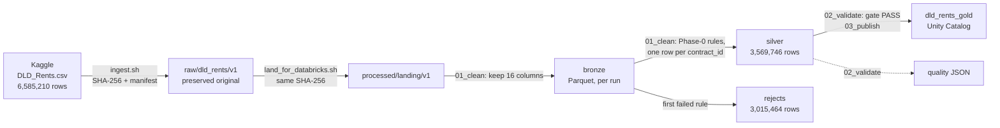

# Catalog, schema and lineage

The published dataset is one Unity Catalog table, `dsai3202_databricks.s_60306080.dld_rents_gold`:
3,569,746 cleaned residential Ejari rent contracts, one row per `contract_id`. It is built by the
Databricks job `dld-rents-pipeline-60306080` (tasks `01_clean` → `02_validate` → `03_publish`).

| Property | Value |
|---|---|
| Table | `dsai3202_databricks.s_60306080.dld_rents_gold` |
| Storage | Delta, `abfss://curated@amazonlake60306080.dfs.core.windows.net/dld_rents/gold` |
| Rows | 3,569,746 (train 2,646,969 · test 922,777) |
| Primary key | `contract_id` (unique; checked by the gate rule `contract_id_unique`) |
| Published by | job run 1037737501698627 (Delta version 20), replaced with identical content by run 950733792217660 (version 41) |
| Source | Kaggle `zainabhejairi/dubai-real-estates-1969-2023`, file `DLD_Rents.csv`, SHA-256 `253b1de0bcc2017f8dc76e47c58cc9831510be302ffdf6129dcc566392519574` |
| Table and column descriptions | stored in Unity Catalog (`COMMENT ON TABLE`, `ALTER COLUMN … COMMENT`, see `databricks/03_publish.py`) |

## Schema: `dld_rents_gold`

| Column | Type | Source column | Meaning and rules |
|---|---|---|---|
| `contract_id` | string | `contract_id` | Ejari contract id. **Primary key**: one row per contract (duplicates removed in `01_clean`). |
| `start_date` | date | `contract_start_date` | Contract start, parsed from `dd-MM-yyyy`. |
| `contract_year` | int | from `start_date` | 2010–2023. Drives the time split. |
| `contract_month` | int | from `start_date` | 1–12. |
| `reg_type` | string | `contract_reg_type_en` | `New` or `Renew`. |
| `area_id` | int | `area_id` | DLD area id. |
| `area_name_en` | string | `area_name_en` | DLD area name; the baseline groups by this. |
| `property_type` | string | `ejari_property_type_en` | e.g. Flat, Villa. |
| `property_sub_type` | string | `ejari_property_sub_type_en` | Holds bedrooms, e.g. `2 bed rooms+hall`, `Studio`. |
| `usage` | string | `property_usage_en` | Always `Residential` after cleaning. |
| `is_free_hold` | string | `is_free_hold` | Freehold flag as in the source (`0`/`1`). |
| `tenant_type` | string | `tenant_type_en` | Person or Authority. EDA only, not a Phase-0 feature. |
| `size_m2` | double | `actual_area` | Property size in m², > 10. |
| `duration_days` | int | end − start | 330–400 (about one year). |
| `annual_amount_aed` | double | `annual_amount` | Annualised rent in AED, ≥ 5,000. |
| `monthly_rent_aed` | double | `annual_amount / 12` | **Target** (reported in AED). |
| `log_monthly_rent` | double | `ln(monthly_rent_aed)` | **Model target** (rents are right-skewed). |
| `split` | string | from `contract_year` | `train` = 2010–2021, `test` = 2022–2023. |
| `published_run_id` | string | job parameter | Job run that published this version. Not a feature. |

## Assumptions

- Dates in the source are `dd-MM-yyyy` (confirmed: `07-04-2019` to `06-04-2020` is a one-year contract).
- `annual_amount` is the annualised rent, so monthly rent = annual / 12 for every contract length kept.
- A residential contract is one with `property_usage_en = Residential`; labour camps, labour-camp rooms and
  portacabins are excluded even when marked residential (checked: every excluded row is one of these).
- When a `contract_id` appears more than once among valid rows, the kept row is the lowest `line_number`,
  then the largest size, then the highest rent, then a hash of the full row (deterministic on reruns).
- Each rejected row records only its **first** failed rule, so reason counts add up to the rejected total.

## Other datasets in the lake

| Dataset | Path | Format | Contents |
|---|---|---|---|
| Raw (preserved) | `raw/dld_rents/v1/DLD_Rents.csv` + `_manifest.json` | CSV | Original file, write-once, never changed |
| Landing copy | `processed/dld_rents/landing/v1/DLD_Rents.csv` | CSV | Same bytes as raw (SHA-256 checked); Databricks reads this because only `processed` and `curated` are Unity Catalog external locations |
| Bronze | `processed/dld_rents/runs/run_id=<id>/bronze` | Parquet | 16 of 28 source columns, all text |
| Silver | `processed/dld_rents/runs/run_id=<id>/silver` | Delta | Accepted rows of that run, typed |
| Rejects | `processed/dld_rents/runs/run_id=<id>/rejects` | Parquet, partitioned by `reject_reason` | Rejected rows with their reason |
| Quality evidence | `curated/dld_rents/quality/run_id=<id>/` | JSON | `clean.json`, `gate.json`, `success.json`, `comparison.json` |
| EDA summary | `curated/dld_rents/eda/eda_summary_<UTC time>.json` | JSON | Key EDA numbers |

## Lineage

Row accounting for run 1: 6,585,210 input = 3,569,746 accepted + 3,015,464 rejected.
Each run's `clean.json` and `success.json` record the exact input, bronze, silver, rejects and gold paths.

## Verification

- Run 1 totals match the Phase-0 scan (6,585,210 rows; 4.89M residential).
- On a real 7,679-row extract of the source, the Spark cleaning and an independent pandas recompute of
  the same rules accepted the identical set of 4,909 contracts, with the same count for every reject reason.

## Known limitation

`01_clean` reads the rejects folder back for its row accounting. An input with zero rejected rows would
leave that folder empty and the task would fail. It does not affect this dataset (3,015,464 rejects).
